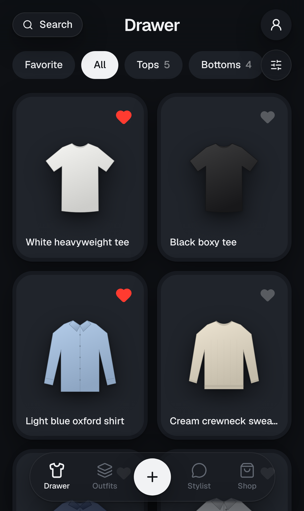
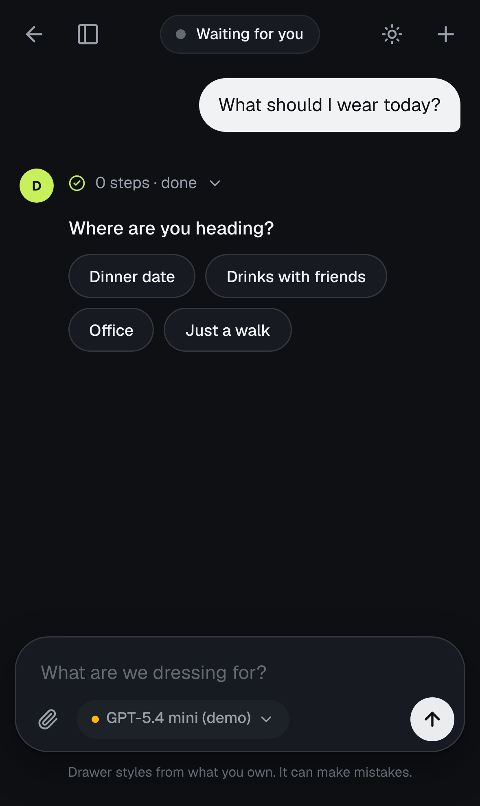
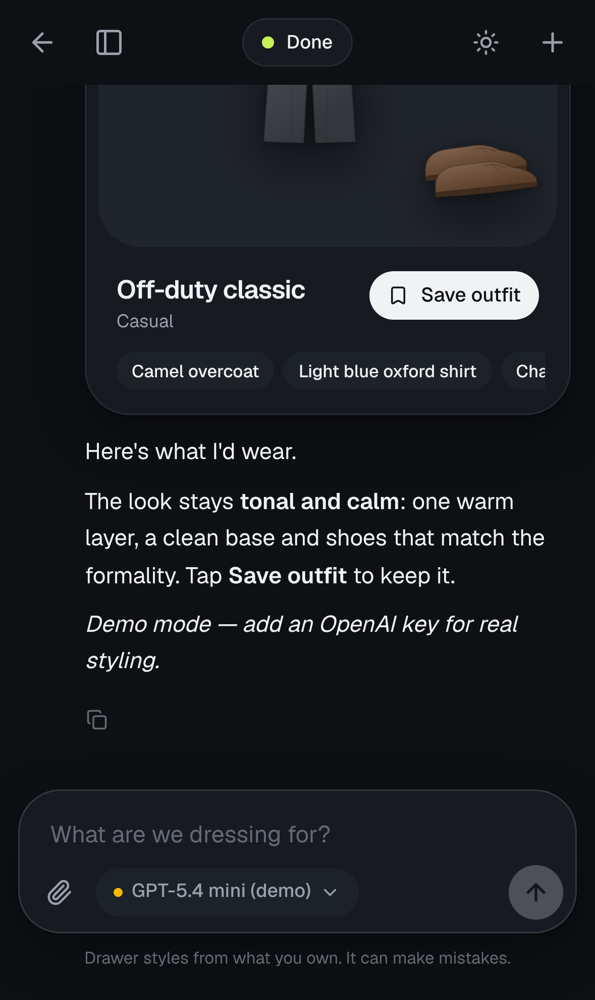
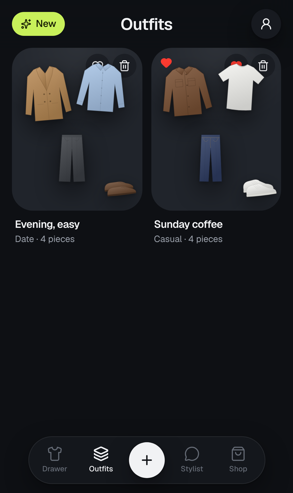
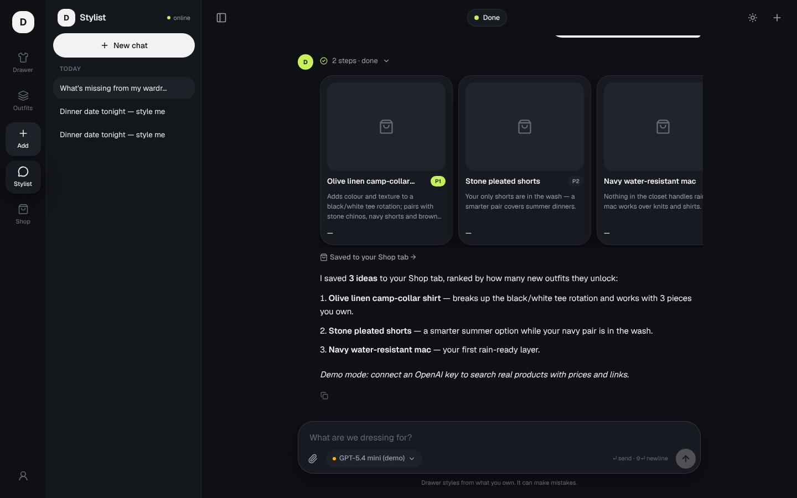

# Outfits

**Your wardrobe, digitised, with an AI stylist that knows every piece you own.**

Snap photos of your clothes → they become clean, professional cut-outs in your digital **Drawer** → chat with a **Stylist** that knows your closet, the weather, the occasion and local culture, and builds outfits from what you actually own → get **Shop** suggestions for what's missing.

Mobile-first PWA · great on desktop · dark by default.

| Drawer | Stylist asks | Outfit board | Saved outfits |
|---|---|---|---|
|  |  |  |  |



## Run it on your machine

Requirements: **Node 20+** (22 recommended) and **pnpm** (`npm i -g pnpm` or `corepack enable`).

```bash
git clone https://github.com/shobky/outfits.git
```

```bash
cd outfits && pnpm install
```

```bash
cp .env.example .env.local
```

Open `.env.local` and paste your key into `OPENAI_API_KEY=` (from https://platform.openai.com/api-keys). Then:

```bash
pnpm dev
```

Open http://localhost:3000. On your phone (same Wi-Fi), use `http://<your-computer-ip>:3000`. Camera upload and "Add to Home Screen" need HTTPS on phones, which you get once it's deployed (see [docs/DEPLOY.md](docs/DEPLOY.md)).

### What you get with just the API key
- **Local mode:** no account and no database setup. Your closet, outfits, chats and photos are saved in `./.data/` (gitignored), so they survive restarts. Back it up by copying that folder.
- 17 **sample pieces** are preloaded so you can try the stylist immediately. Remove them in **Profile → Remove**, or start empty with `DEMO_SEED=0`.
- **Stylist:** pick *GPT-5.4 mini* (fast) or *GPT-5.5* (best taste) in the model pill. *Demo stylist* works offline without a key.
- **Upload:** tap **+**. The first upload downloads the ~40MB cut-out model into your browser (cached afterwards). With a key, items are tagged automatically. Without one, you fill in the details yourself.

### Optional: Supabase (sync across devices + login)
Fill `NEXT_PUBLIC_SUPABASE_URL` and `NEXT_PUBLIC_SUPABASE_ANON_KEY`, then run `supabase/migrations/0001_init.sql` in the Supabase SQL editor. Full steps are in [docs/DEPLOY.md](docs/DEPLOY.md).

## Environment variables
| Variable | Needed? | What it does |
|---|---|---|
| `OPENAI_API_KEY` | for real AI | stylist chat, web product search, photo tagging |
| `VISION_MODEL` | no | model for photo tagging (default `gpt-5.4-mini`) |
| `LOCAL_PERSIST` | no | `0` = keep local data in memory only |
| `DEMO_SEED` | no | `0` = start with an empty drawer |
| `NEXT_PUBLIC_SUPABASE_URL` / `_ANON_KEY` | no | switch from local mode to Supabase (adds login) |

## Scripts
`pnpm dev` · `pnpm build && pnpm start` · `pnpm lint` · `npx tsc --noEmit`

## Stack
Next.js 16 (App Router, Cache Components) · AI SDK v7 + OpenAI · Supabase (optional) · Tailwind v4 · Radix · Streamdown · in-browser background removal (@imgly, ONNX) · Open-Meteo weather · Vercel.

## Docs
- [Plan & roadmap](docs/PLAN.md): what's done and what's next
- [Architecture](docs/ARCHITECTURE.md) · [Data model](docs/DATA_MODEL.md) · [Design system](docs/DESIGN.md)
- [Stylist (prompt, skills, evals)](docs/STYLIST.md) · [Research & decisions](docs/RESEARCH.md)
- [Deploy to outfits.shobky.com](docs/DEPLOY.md)
- For coding agents (Claude Code / Codex): [AGENTS.md](AGENTS.md) and `.claude/skills/`

## Troubleshooting
- **"AI in demo mode"** on the Profile page: the key isn't loaded. Check `.env.local` (not `.env.example`) and restart `pnpm dev`.
- **Cut-out is slow:** the first run downloads the model, and it runs faster on browsers with WebGPU (Chrome, Edge).
- **Reset everything:** stop the server and delete `.data/`.
